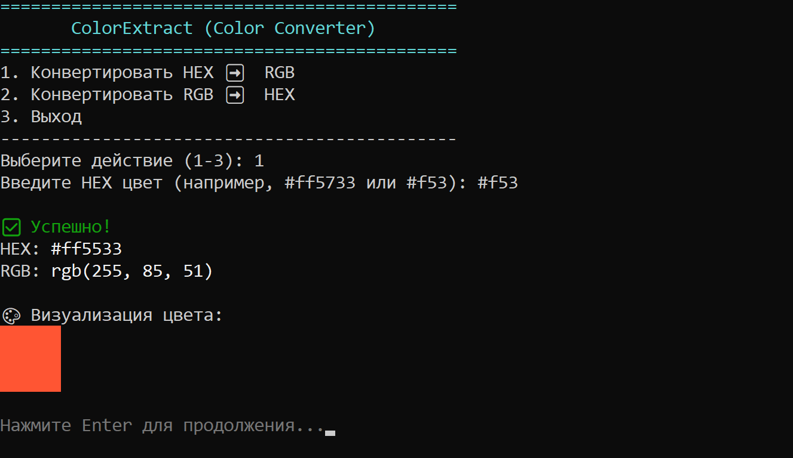

# 🎨 ColorExtract

<p>
  
</p>

**ColorExtract** is a lightweight, fast Python CLI tool designed to instantly convert colors between **HEX** and **RGB** formats right inside your terminal. Built specifically for web developers and designers who value speed and efficiency in a console environment.

The core feature of this utility is its **interactive color visualization** powered by Truecolor (24-bit ANSI) sequences, which renders a preview block of the resulting color directly in the terminal window.

---

## ✨ Features

- **Two-way Conversion:** HEX ➡️ RGB and RGB ➡️ HEX.
- **Smart Validation:** Robust input verification (error handling, support for short 3-character HEX shorthand like `#f53`).
- **Visual Preview:** Renders a colored block directly in the console for instant visual feedback.
- **Cross-platform Support:** Correctly displays ANSI colors across Linux/macOS and Windows (CMD/PowerShell).
- **Clean Architecture:** Well-structured OOP code splitting conversion logic from the terminal UI.

---

## 🚀 Installation & Usage

### Requirements
- Python 3.6+
- A modern terminal emulator with Truecolor support.

### Running the App
The project uses only Python built-in modules (`os`, `re`, `sys`), meaning **zero external dependencies** are required.

1. Clone the repository:
   ```bash
   git clone https://github.com/OkamiCoder/ColorExtract/
   cd ColorExtract
   ```

2. Run the script:
   ```bash
   python color_extract.py
   ```

---

## 🛠️ Tech Stack

- **Language:** Python 3
- **Modules:** `sys`, `os`, `re` (Python Standard Library)
- **UI & Styling:** ANSI Escape Sequences (Truecolor / 24-bit color)

---

## 📝 Roadmap

- [ ] Add clipboard support (auto-copying results to the clipboard via `pyperclip`).
- [ ] Add CLI arguments support (e.g., run `python color_extract.py #ff5733` for instant conversion without opening the menu).
- [ ] Add a random color generator.

---
Made with ❤️ by [OkamiCoder](https://github.com/OkamiCoder/)
